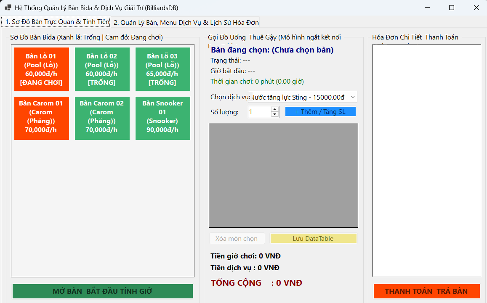
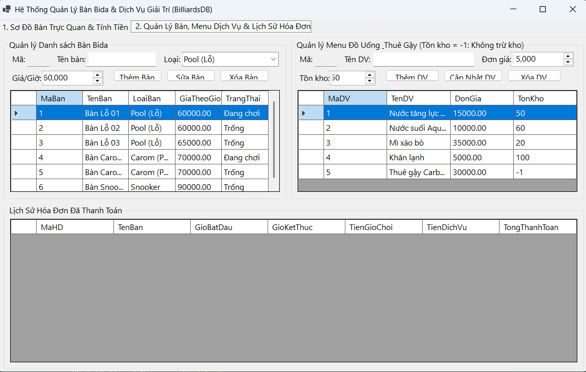
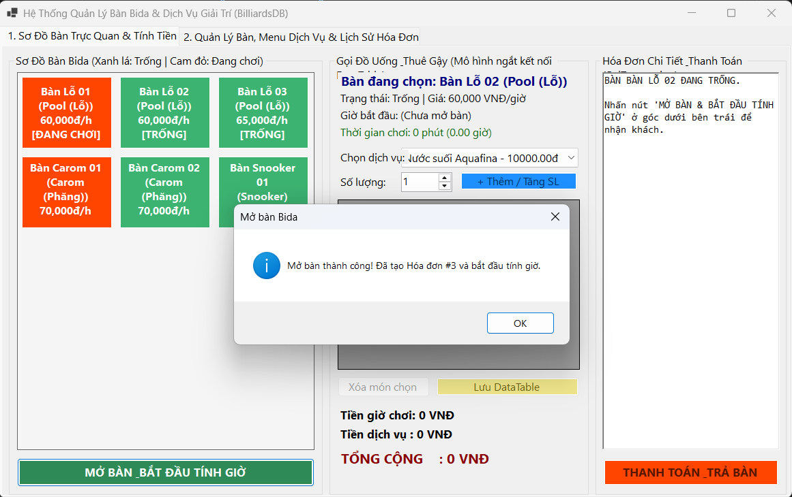
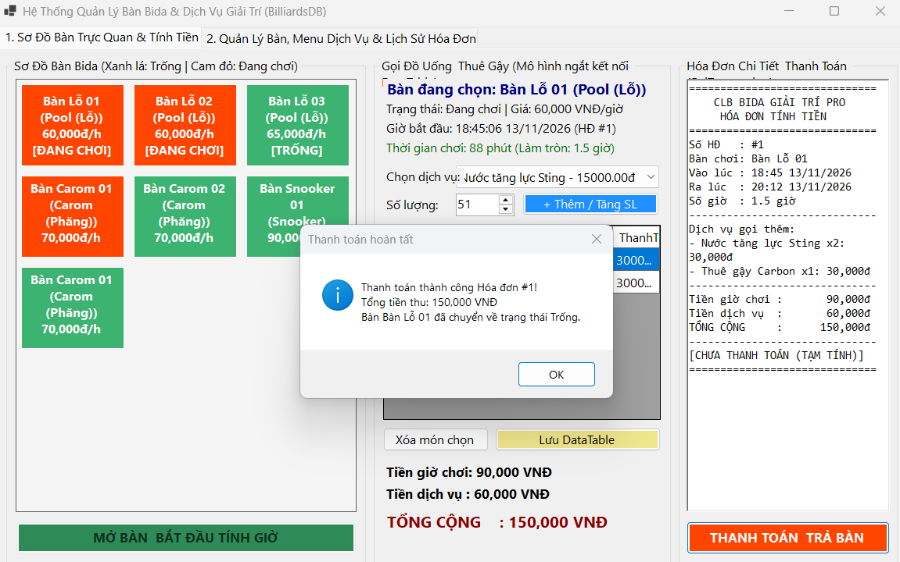
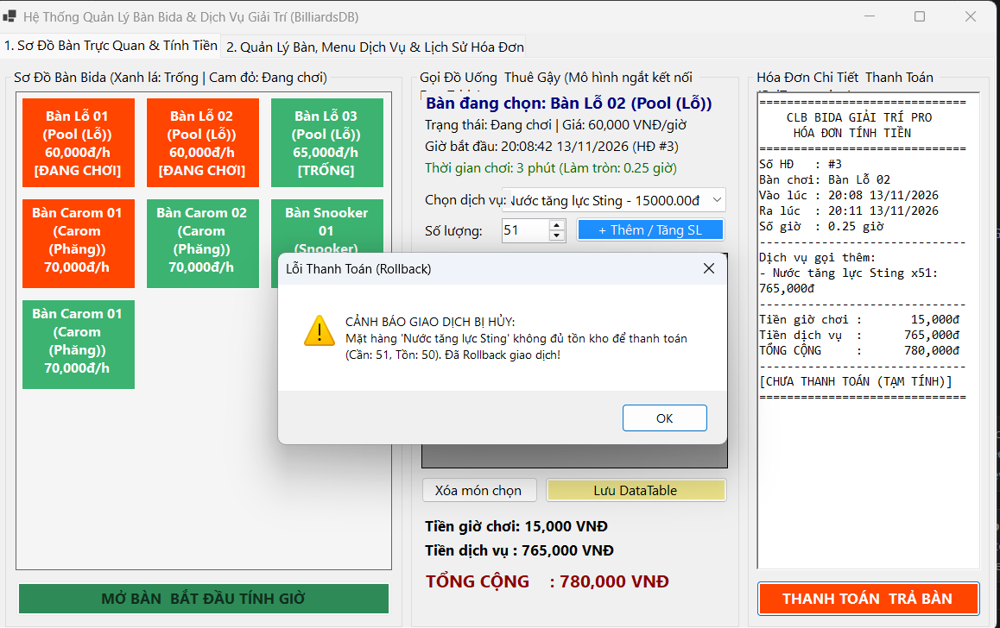

# BÁO CÁO BÀI TẬP 6.8: HỆ THỐNG QUẢN LÝ BÀN BIDA & DỊCH VỤ GIẢI TRÍ (BILLIARDS CLUB MANAGEMENT SYSTEM)

## MỤC 1: THÔNG TIN SINH VIÊN
* **Họ và tên sinh viên:** Đỗ Quang Toàn
* **Mã sinh viên:** 24810320100
* **Lớp / Khóa:** D19QTANM1

---

## MỤC 2: HÌNH ẢNH KẾT QUẢ CÁC MÀN HÌNH CHỨC NĂNG

1. **Màn hình Chính / Sơ đồ Bàn Bida trực quan (Visual Grid Layout):**
   

2. **Màn hình Quản lý Danh mục (Quản lý Bàn Bida & Menu Dịch vụ):**
   

3. **Màn hình Thực thi Nghiệp vụ chính (Mở bàn, Gọi món theo mô hình ngắt kết nối DataTable & Thanh toán):**
   

4. **Màn hình Báo cáo - Lịch sử Hóa đơn & In Phiếu Tính Tiền:**
   

5. **Minh họa An toàn Dữ liệu (Transaction Rollback khi tồn kho dịch vụ không đủ):**
   

---

## MỤC 3: CẤU TRÚC THƯ MỤC & KIẾN TRÚC 3-TIER

```text
BilliardsManagement/
├── Database/
│   └── ScriptDB.sql              # Script khởi tạo CSDL BilliardsDB (4 bảng) và dữ liệu mẫu
├── DTO/                          # Data Transfer Object: Các lớp thực thể ánh xạ CSDL
│   ├── BanBidaDTO.cs
│   ├── MenuDichVuDTO.cs
│   ├── HoaDonDTO.cs
│   └── ChiTietHoaDonDTO.cs
├── DAL/                          # Data Access Layer: Truy vấn SQL Server, SqlDataAdapter & SqlTransaction
│   ├── DBConnect.cs
│   ├── BanBidaDAL.cs
│   ├── MenuDichVuDAL.cs
│   └── HoaDonDAL.cs
├── BUS/                          # Business Logic Layer: Xử lý mở bàn, tính giờ chơi tự động, thanh toán
│   ├── BanBidaBUS.cs
│   ├── MenuDichVuBUS.cs
│   └── HoaDonBUS.cs
├── GUI/                          # Presentation Layer: Sơ đồ bàn trực quan & giao diện quản lý
│   └── FormMain.cs
├── images/                       # Thư mục lưu hình ảnh minh họa báo cáo
├── App.config                    # Cấu hình chuỗi kết nối SQL Server
├── Program.cs                    # Điểm khởi chạy ứng dụng
├── BilliardsManagement.csproj    # File cấu hình Project .NET
└── README.md                     # Báo cáo chi tiết bài tập


